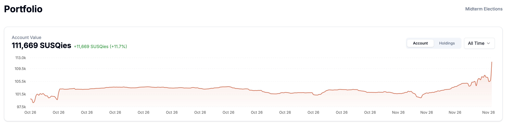

# Super Market Trading Bot

An automated Python bot for **The Super Market** 2026 Midterm Elections tournament
(SIG site). It targeted a **safe top-N finish**: locked-profit arbitrage first,
directional trades only where there was an independent view, and hard caps so no
single settlement could sink the standing.

## Final result

The tournament has ended. Final standing:

| Metric | Result |
| --- | --- |
| Starting balance | 100,000 SUSQies |
| Final profit | **+11,669 SUSQies** (+11.7%) |
| Ending balance | 111,669 SUSQies |
| Rank | **470 of 1,969** (top ~24%) |

<!-- Insert final leaderboard / results screenshot below -->


The profit came from two sources running in parallel for most of the tournament:
market-making the gap while Super Market prices lagged Kalshi/Polymarket, and
buy-and-hold directional positions anchored to those outside fair values. In the
final ~10 hours, as the external anchors thinned and the races began resolving,
the bot switched entirely to buy-and-hold and rode its positions to settlement
without paying the spread on exits (see [Strategy evolution](#strategy-evolution)).

## Strategy

Each cycle executes in this priority order:

1. **Close (`close`).** Two reasons to exit a held side, both needing a
   fair-value view. **Take profit** (`TAKE_PROFIT`, on by default): the market
   has reached your fair value, so sell into the book. **Negative-edge cut**
   (`CLOSE_NEGATIVE_EDGE`, off by default): the held side's edge at the current
   sell price has fallen to/below `CLOSE_EDGE_THRESHOLD`, so holding no longer
   has positive expected value — sell regardless of P&L (never on entry price,
   to avoid a sunk-cost trap). Closes bypass all caps.
2. **Arbitrage (multi-outcome markets).** At most one outcome can win, so buying
   NO on every outcome pays at least `n - 1`. When the best YES bids sum above 1,
   that basket locks in `sum(bids) - 1` per set. It is placed atomically via
   `/orders/multi-leg`. A YES basket (`sum(asks) < 1`) is opt-in because it is
   only safe when exactly one outcome must win. Binary markets have no internal
   arbitrage, since YES ask + NO ask = 1 + spread.
   **Across linked markets**, the platform's relationship graph (`/relationships`)
   says which markets are logically tied. The bot checks those links against live
   bid/ask, not the engine's last-traded prices, and only trades a basket that
   pays at least 1 per set whatever happens:
   - *implication* (A ⇒ B, e.g. "wins by 10+" ⇒ "wins"): if bid(A) > ask(B), buy
     YES B and NO A;
   - *complementary* (exactly one true): YES basket if asks sum < 1, NO basket if
     bids sum > 1;
   - *mutually exclusive*: NO basket if bids sum > 1; YES basket only when marked
     exhaustive;
   - *monotonic* thresholds: treated as implications, oriented by the engine's own
     suggested corrective trades.

   Boolean and conditional relationships are listed but never auto-traded. Two
   baskets that share an exchange are never placed in the same cycle.
3. **Mispricing (`open`).** When your fair value beats the executable price by
   `MIN_EDGE`, the bot walks the book while the edge holds and buys up to a
   fractional-Kelly target. Existing holdings count toward that target.

Risk caps are fractions of **equity** (cash + position value): per market, total,
a cash reserve, and a net D-vs-R cap across exchanges you tag with a `lean`.
An open is skipped if fair value and the book differ by more than `MAX_EDGE`
(0.25). A gap that large usually means a bad mapping. A **high-confidence lane**
raises the per-race cap to `HIGH_CONF_MARKET_CAP` for a side whose own fair value
is at least `HIGH_CONF_THRESHOLD` (default 0.95), so near-certain outcomes can
take a larger position than the ordinary per-market cap allows.

Fair values come from **Kalshi and Polymarket** prices for exchanges you approve
(see below), optionally overridden by your own `fair_values.json`. With neither,
the bot runs **arbitrage-only**.

## Strategy evolution

The live strategy changed across the tournament as the field, the mappings, and
the clock moved. In rough order:

1. **Arbitrage + mispricing core.** The first working bot did locked-profit
   arbitrage (multi-outcome NO baskets, then cross-market relationship baskets)
   plus fractional-Kelly directional opens wherever an independent fair value
   beat the Super Market price by `MIN_EDGE`. An early rewrite corrected a wrong
   assumption that binary markets contain internal arbitrage (they do not: YES
   ask + NO ask = 1 + spread), and fixed pagination, tick snapping, NO-side
   quantity signs, and order pile-up.

2. **Outside price anchors.** Added read-only Kalshi and Polymarket feeds and a
   `mappings.json` matcher (`suggest` / `approve` / `check`) so fair values came
   from real external markets rather than guesses. The matcher was hardened over
   several passes (year preference, margin-bracket penalties, office/state gates,
   district exact-match) until ~221 of 237 markets were mapped and approved.

3. **Market maker.** On a dedicated `market-maker` branch, added a two-sided
   quoting strategy with its own budget, inventory skew/caps, and a separate
   accounting bucket (`MAKER_BUDGET`, not `MAX_TOTAL_EXPOSURE`). It was ramped in
   stages (10% → 30% → 45% budget, 5 → 20 markets) and the half-spread tightened
   from 0.02 to 0.015 for more fills as Super Market prices converged toward
   Kalshi. This ran alongside buy-and-hold, which took the directional side.

4. **Endgame features (coded, held in reserve).** Near settlement, two optional
   features were added: a **high-confidence lane** (a larger per-race cap for
   sides whose fair value is ≥ `HIGH_CONF_THRESHOLD`) and **negative-edge
   position closing** (`CLOSE_NEGATIVE_EDGE`, sell any held position whose edge
   has fallen to/below `CLOSE_EDGE_THRESHOLD`). A dry run showed a 0.0 close
   threshold the day before settlement would liquidate ~34 positions — including
   strong-thesis holds — by buying them back across the spread on markets that
   resolve 0/1 anyway. So the close feature was left **off**: the losses it
   flagged were mostly Super Market mids converging to Kalshi, not broken theses.

5. **Hold to settlement.** In the final ~10 hours, as Kalshi/Polymarket races
   began resolving and usable external anchors dropped sharply (221 → ~46), the
   bot was switched **entirely to buy-and-hold**: the maker disabled
   (`MAKER_ENABLED=false`, handing its inventory to buy-and-hold) and take-profit
   turned off (`TAKE_PROFIT=false`), so every position simply rides to
   resolution with no spread paid on exits. Quoting without reliable anchors on
   election night is the main pick-off risk, and this posture removes it.

## Order hygiene

- Prices are snapped to the API's 0.005 tick. Buys round down and sells round up.
- Every order is a limit order with a TTL (`ORDER_TTL_SECONDS`).
- Live cycles start by cancelling the bot's open orders in the tournament, so
  remainders never accumulate. This also cancels orders placed by hand.
- Live cycles do nothing outside the tournament window (from `startDate`/`endDate`).
- Retries reuse the same `idempotencyKey`, so a retried order is never placed twice.

## Layout

```
src/supermarket_bot/
  config.py      settings (SUPERMARKET_* env vars)
  models.py      API models, tick snapping, trading window
  client.py      REST client (auth, retries, pagination, tournament scoping)
  external.py    read-only Kalshi / Polymarket price feeds
  mapping.py     mappings.json + title matching for `suggest`
  fair_value.py  fair-value providers (external / static JSON / composite)
  signals.py     close / arbitrage / mispricing detection
  relationships.py  cross-market arbitrage from the relationship graph
  risk.py        equity-based sizing and caps
  execution.py   multi-leg + batch submission (dry-run aware)
  engine.py      one cycle + run loop
  __main__.py    CLI: tournaments | status | markets | suggest | check | once | run
bot              launcher script (use ./bot ...)
```

## Setup

```bash
python3 -m venv .venv && source .venv/bin/activate
pip install -r requirements-dev.txt && pip install -e .
cp .env.example .env   # set SUPERMARKET_API_KEY; keep DRY_RUN=true at first
```

The key needs the `read` and `trade` scopes. Accept the current terms on the site
first, or orders fail with `TERMS_NOT_ACKNOWLEDGED`.

## Usage

Run commands with `./bot` from the project folder. It works even when macOS
breaks the `supermarket-bot` command (see Troubleshooting).

```bash
./bot tournaments      # find your tournament slug -> SUPERMARKET_TOURNAMENT_SLUG
./bot status           # window, cash, rank, positions
./bot markets          # market + exchange ids
./bot suggest          # propose Kalshi/Polymarket matches into mappings.json
./bot approve          # bulk-approve clean matches and fill D/R lean (review after!)
./bot check            # approved mappings: Super Market book vs outside fair value
./bot relationships    # linked markets + any cross-market arbitrage right now (-v: list all)
./bot once             # one dry-run cycle
./bot run              # loop (add --fair-value fair_values.json for your own views)
```

To go live, read the `[DRY-RUN]` lines from `once`. When they look right, set
`SUPERMARKET_DRY_RUN=false`.

## Outside prices (Kalshi + Polymarket)

Both sites publish market data for free with no account. The bot only reads it
and never trades there. One batched request per site per cycle stays far below
their published rate limits.

1. `./bot suggest` searches both sites for each open Super Market exchange. It
   writes `mappings.json` with the top 3 candidates per site and pre-fills the
   best one. Every entry starts as `"approved": false`.
2. Review each entry in `mappings.json`:
   - Check `ref` points at the same question, with the same race, year and
     resolution. Swap in another candidate from `suggestions` if needed, or set
     the source to `null`.
   - Set `"invert": true` if Super Market YES is that contract's NO.
   - Add `"lean": "D"` or `"R"` (the party a YES outcome favours) for the
     correlation cap.
   - Set `"approved": true`. Only approved entries are traded.
3. `./bot check` shows the Super Market bid/ask next to the outside fair value,
   so you can spot bad matches before trading. A fair value near `1 - price`
   usually means a missing `invert`.

Each cycle, per approved exchange, the bot:

- ignores quotes with a spread wider than `EXTERNAL_MAX_SPREAD` (0.08);
- skips the exchange if Kalshi and Polymarket mids differ by more than
  `EXTERNAL_MAX_DISAGREEMENT` (0.05);
- uses the volume-weighted midpoint as fair value, with confidence 0.8 for two
  agreeing sources or 0.5 for one, lowered as spreads widen;
- gets no fair value from a source that fails to respond. Stale prices are
  never reused.

Re-running `suggest` adds new markets and never changes approved entries.

## Your own views (optional)

`fair_values.json` maps `exchangeId` to your probability that YES resolves
true, plus optional `confidence` and `lean`. See `fair_values.example.json`. It
overrides outside prices for any exchange it lists. The file is re-read every cycle.
If it becomes unreadable, the last good values are kept.

## Market making (optional, off by default)

With `SUPERMARKET_MAKER_ENABLED=true`, each cycle the bot also rests two limit
orders on up to `MAKER_MAX_MARKETS` exchanges that have a fair value:

- a YES bid at about `fair - MAKER_HALF_SPREAD`;
- a YES ask at about `fair + MAKER_HALF_SPREAD`, sent as a NO buy at `1 - ask`.

If both fill, the YES and NO shares cancel into 1 SUSQie per pair, so the round
trip earns the gap whichever way the race goes. Quotes are cancelled and
replaced every cycle.

Pricing: never at or through fair value, at most one tick ahead of the current
best, and never crossing the book, so quotes always rest instead of taking.

Inventory control:
- quotes shift away from held inventory (`MAKER_SKEW`), so the reducing side
  gets more attractive;
- at `MAKER_MAX_INVENTORY` net cost, the side that would add stops quoting;
- new inventory also respects `MAKER_BUDGET`, the cash reserve, the per-race
  cap and the D-vs-R cap.

The two strategies never mix. The maker records the exchanges it manages in
`state/maker.json` and stays out of races where buy-and-hold holds a position.
Buy-and-hold stays out of the maker's exchanges. `./bot status` tags maker
positions `MM`. Maker inventory counts against `MAKER_BUDGET`, not
`MAX_TOTAL_EXPOSURE`.

The maker stops quoting `MAKER_STOP_HOURS_BEFORE_END` hours (default 36) before
the tournament ends. On election night prices jump faster than a 60-second
cycle can requote. Inventory left over is held to settlement. Turning the
maker off hands that inventory back to buy-and-hold.

## Development

```bash
ruff check src tests && mypy && pytest
```

## Troubleshooting

`ModuleNotFoundError: No module named 'supermarket_bot'` from `supermarket-bot`
means macOS set the `hidden` flag on the editable-install `.pth` file, and
Python 3.13 skips hidden `.pth` files. It keeps coming back for projects on the
Desktop. Use `./bot` instead, which doesn't depend on that file. For a one-off
fix, run `chflags nohidden .venv/lib/python3.13/site-packages/*.pth`.

## Limitations

- The Super Market orderbook endpoint is slow and uneven (sub-second to 20s+).
  The bot fetches books concurrently (`SCAN_CONCURRENCY`) with a per-request
  timeout, so a full ~240-market scan takes seconds and one stalled market is
  skipped rather than hanging the cycle.
- The bot takes liquidity at visible prices. It does not quote inside the spread.
- Cross-market baskets count against the total-exposure cap and cash reserve,
  not the per-market cap, since their payoff is locked.
- An arbitrage basket is accepted atomically, but fills are not guaranteed. If a
  leg rests, it is cancelled and a warning is logged, and that basket may be
  partly unhedged.
- If positions cannot be valued, the API returns 409, so that cycle is skipped
  rather than trading blind.
